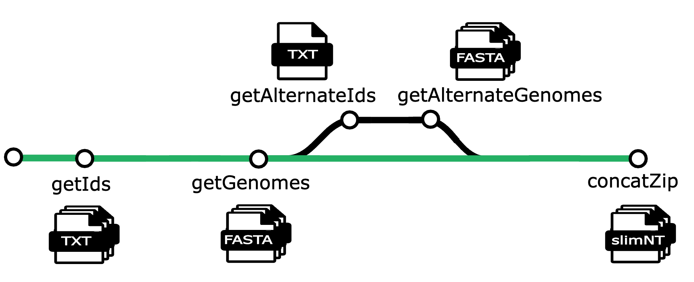

# slimNT

slimNT has been developed to provide a curated, streamlined version of the NT database. Metagenomic analysis can be difficult and time consuming when querying against the 368001 genomes in NT, and the necessary indexing step is resource heavy; both time and computationally. slimNT aims to solve that problem by strategically sub setting the NT database to create a compact, user-defined database that is tailored to specific needs.

The slimNT database is derived from Representative Proteome (RPs) and Reference Proteome Groups (RPGs) provided by [Protein Information Resource (PIR)](https://proteininformationresource.org/rps/). Reference proteomes and viral reference proteomes can be selected based on a desired cutoff thresholds. Selecting a higher cutoff value will create a larger, more robust database that will lend to increased accuracy at the expense of computation time. Conversely, selecting a lower threshold will result in a database that can be queried more quickly, but may only identify more distantly related sequences.

The build is a set of bash scripts (with a Python fallback helper) driven by `run_pipeline.sh`. The original Nextflow implementation is kept in `legacy/` for reference only.

## Contact Us
To contact us about any questions or feedback, please email us at mazumder_lab@gwu.edu

## Data Collection

A list of non-viral proteome ids are generated from PIR. Cut-off values of [(75%)](https://proteininformationresource.org/rps/data/current/75/rpg-75.txt), [(55%)](https://proteininformationresource.org/rps/data/current/55/rpg-55.txt), [(35%)](https://proteininformationresource.org/rps/data/current/35/rpg-35.txt), and [(15%)](https://proteininformationresource.org/rps/data/current/15/rpg-15.txt). These options will result in 18614, 11895, 6072, and 1989 RPGs respectively.

A list of viral proteome ids are generated similarly. Cut-off values of [(95%)](https://proteininformationresource.org/rps/viruses/data/current/95/rpg-95.txt), [(75%)](https://proteininformationresource.org/rps/viruses/data/current/75/rpg-75.txt), [(55%)](https://proteininformationresource.org/rps/viruses/data/current/55/rpg-55.txt), [(35%)](https://proteininformationresource.org/rps/viruses/data/current/35/rpg-35.txt), [(15%)](https://proteininformationresource.org/rps/viruses/data/current/15/rpg-15.txt), resulting in 15502, 10256, 7971, 6334, 4689 RPGs.

There is a secondary group of viral RPGs that include polyproteomes that can be found [here](https://proteininformationresource.org/download/rps/rpg_virus_all/current/).

UniProt provides a dataset that can be used to map proteome ids to their associated Genbank or RefSeq IDS [(mapping dataset)](https://www.uniprot.org/proteomes?query=*).

This version of slimNT was designed to be as diverse and robust as possible, and the highest cut-offs were selected (95% cut-off for viral RPGs including polyproteomes, and 75% cut-off for all others). Eukaryotes are excluded except for those listed in `pipeline/eukaryotes_whitelist.txt`. The cut-off URLs are set in `pipeline/config.sh`.

## Pipeline



All steps are in `pipeline/` and share helpers from `pipeline/config.sh`. Every step writes into the output directory given to `run_pipeline.sh`, and logs go to `<output>/logs/`.

### 1) Get IDs — `1_get_ids.sh`
Downloads the UniProt proteome→assembly mapping and the PIR RPG lists (or reuses cached copies from `--input-data-dir`). Keeps non-eukaryote representative proteomes plus whitelisted eukaryotes, and appends `supplemental_upids.txt` unless `--no-supplemental` is given. Writes:
- `ids.txt`: selected proteome IDs
- `mapped.db`: their genome assembly accessions
- `assembly_to_upid.txt`: assembly → proteome
- `unmapped_proteomes.txt`: selected proteomes with no genome assembly in UniProt

The step stops with an error if the mapping file is missing or implausibly small, or if no proteomes are selected from PIR.

### 2) Get genomes — `2_get_genomes.sh`
Downloads each assembly in `mapped.db` from the NCBI Datasets API (`GENOME_FASTA`, 3 attempts with backoff) and extracts the `.fna`. Existing ZIPs/FNAs are reused, so reruns only fetch what is missing. Failures go to `logs/2_failed_downloads.txt` and `logs/2_extraction_failed.txt`; empty FNAs go to `genomes/empty_list.txt`.

### 3) Get alternate IDs — `3_get_alternate_ids.sh`
For assemblies that failed to download or produced an empty FNA, looks up the paired RefSeq/GenBank accession (GCF ↔ GCA) in NCBI's assembly summary. Writes `genomes/alt_map.txt` (original → alternate) and `genomes/alt_ids.txt`.

### 4) Get alternate genomes — `4_get_alternate_genomes.sh`
Downloads and extracts the alternates from step 3, the same way as step 2.

### 5) Nucleotide fallback — `5_fetch_fallback.sh`
Builds `fallback_queue.txt`: the unmapped proteomes, plus proteomes whose assembly has no usable FNA under either accession. For each, `scripts/fetch_nucleotide_fallback.py` asks UniProt for the proteome's nucleotide accessions and downloads them with NCBI efetch into `fallback_genomes/<UPID>.fna`. Outcomes are logged to `logs/fallback_retrieval.jsonl`.

The step refuses to run if the queue is larger than `FALLBACK_MAX_UPIDS` (default 5000; a normal build queues a few hundred). A larger queue almost always means step 1 went wrong.

### 6) Concatenate — `6_concat_zip.sh`
Builds `slimNT.fa` from an explicit manifest: one FNA per assembly in `mapped.db` (or its alternate), plus the fallback FNAs for the UPIDs in `fallback_queue.txt`. Any other `.fna` files in `genomes/` or `fallback_genomes/` are reported and left out. Fallback records whose sequence ID already appears in an included genome, or earlier in the fallback set, are dropped (listed in `logs/6_dropped_fallback_records.txt`). The output is uncompressed, ready for `makeblastdb`.

# Running slimNT

## Set up your environment

Clone the repository and ensure the following are available on your `PATH`:

- `bash` (4.0+) and GNU coreutils/findutils (`xargs -d`, `find -printf`), `flock`
- `python3` (3.6 or newer; the scripts avoid newer syntax so they run on older HPC images)
- `wget`, `curl`
- `gzip`, `unzip`

Optionally set `NCBI_API_KEY` to raise NCBI's efetch rate limit in step 5.

A full build needs at least **500 GB** free in the output directory. The pipeline creates that directory (and its logs) automatically.

## Run the pipeline

Full build:

```bash
bash run_pipeline.sh -o /path/to/output --build
```

Without `--build`, the pipeline runs a **smoke test**: it skips the PIR/UniProt downloads and steps 2–4, and only processes the UPIDs in `pipeline/supplemental_upids.txt` (~5 GB). Use it to check the environment and the fallback path end to end. It does not produce a usable database.

Options:

| Option | Purpose |
|---|---|
| `--build` | Full production build |
| `--input-data-dir DIR` | Reuse cached `rpg-75.txt`, `rpg-virus-95.txt` and `mapping.txt` instead of downloading them (default: `<output>/input_data`) |
| `--no-supplemental` | Leave out `supplemental_upids.txt` (used for the "base" artifact) |
| `--backup-dir DIR` | Copy genome ZIP/FNA files from `DIR/genomes/` when present instead of downloading |
| `-h`, `--help` | Show usage |

Only one run can use a given output directory at a time. A second `run_pipeline.sh` on the same directory exits immediately.

Builds take days. Run detached and follow the progress:

```bash
nohup bash run_pipeline.sh -o /path/to/output --build > build.log 2>&1 &
tail -f build.log
```

All steps are safe to rerun: downloaded ZIPs, extracted FNAs and fallback FNAs are reused, and per-run lists and logs are regenerated.

## Outputs

- **`slimNT.fa`**: concatenated genome FASTA
- **`slimNT.manifest.txt`**: the exact files that went into `slimNT.fa`, in order
- **`missing_fna.txt`**: assemblies with no FNA under either accession (step 5 tries these through the fallback)
- **`fallback_queue.txt`**: proteomes sent to the nucleotide fallback
- **`logs/fallback_retrieval.jsonl`**: one JSON object per fallback event; each run starts with `session_start` (including the queue size) and ends with `session_end`

## Choosing organisms

### Eukaryote whitelist
Eukaryotes are excluded unless their proteome ID (UPID) is listed in `pipeline/eukaryotes_whitelist.txt`: one UPID per line, with an optional `# organism name` comment. Matching is by UPID, not organism name. Find UPIDs on [UniProt Proteomes](https://www.uniprot.org/proteomes).

### Supplemental proteomes
`pipeline/supplemental_upids.txt` adds proteomes that the PIR lists miss, or whose assembly path is unreliable. Format:

```
UP000120560  NC_001940.1
UP000007253  M24734.1,AF378003.1
```

Column 1 is added to the build. Column 2 (optional, comma-separated) gives NCBI nucleotide accessions for step 5 to use when UniProt has none. For proteomes that come through PIR normally but have no UniProt nucleotide links, add accessions to `MANUAL_ACCESSIONS` in `scripts/fetch_nucleotide_fallback.py` instead.

## Helper scripts

- `scripts/verify_downloads.sh OUTDIR`: checks genome and fallback completeness before a rebuild
- `scripts/collect_failures.py`: gathers all failure logs into a curator-ready TSV
- `scripts/check_proteome_mapping.py`: queries UniProt and NCBI for a list of UPIDs
- `scripts/setup_artifacts.sh`: one-time migration used to split the v3.1 output into `base/` and `annotated/` artifacts; not needed for new builds
